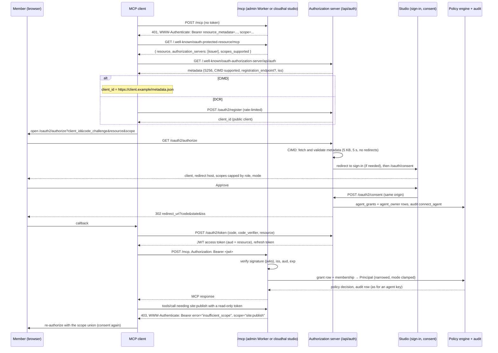

# RFC-0044: Remote MCP authorization: OAuth 2.1 for Cloudhal deployments

- Status: Draft
- Author: Halil (Madraka), drafted with Claude · Date: 2026-11-08
- Related:
  - [#144](https://github.com/cloudhal-dev/cloudhal/issues/144) (problem statement and phases);
    [#143](https://github.com/cloudhal-dev/cloudhal/issues/143) (self-host image, `--base-url`:
    this RFC depends on it, §10).
  - ADR-0004 (MCP server; addendum "No OAuth provider"), ADR-0010 (Better Auth; "MCP
    authorization (Sprint 5)"), ADR-0011 §5–6 (agent layer; OAuth 2.1 deferred), ADR-0014
    (out-of-band approvals), ADR-0015 / ADR-0016 (agent modes, elevations), ADR-0018 (roles),
    RFC-0005 (roles and keys, I1/I5/I6/I7), RFC-0034 (multi-site installations, A2 per-site
    roles), RFC-0036 (playground), RFC-0004 §5.7 (`workersTransport`, Workers cannot pin DNS).
  - Primary sources (read 2026-11-08):
    - MCP Authorization, current revision 2026-07-28:
      [authorization](https://modelcontextprotocol.io/specification/2026-07-28/basic/authorization),
      [client registration](https://modelcontextprotocol.io/specification/2026-07-28/basic/authorization/client-registration),
      [security considerations](https://modelcontextprotocol.io/specification/2026-07-28/basic/authorization/security-considerations);
      the [2025-11-25](https://modelcontextprotocol.io/specification/2025-11-25/basic/authorization)
      and [2025-06-18](https://modelcontextprotocol.io/specification/2025-06-18/basic/authorization)
      revisions; the [draft](https://modelcontextprotocol.io/specification/draft/basic/authorization)
      (adds RFC 9207 `iss` validation and the scope-union rule for step-up).
    - [RFC 9728](https://www.rfc-editor.org/rfc/rfc9728.html) protected resource metadata,
      [RFC 8414](https://www.rfc-editor.org/rfc/rfc8414.html) AS metadata,
      [RFC 7591](https://www.rfc-editor.org/rfc/rfc7591.html) dynamic client registration,
      [RFC 8707](https://www.rfc-editor.org/rfc/rfc8707.html) resource indicators,
      [RFC 9068](https://www.rfc-editor.org/rfc/rfc9068.html) JWT access tokens,
      [RFC 8252 §7.3](https://datatracker.ietf.org/doc/html/rfc8252#section-7.3) loopback
      redirects, [RFC 9207](https://datatracker.ietf.org/doc/html/rfc9207) issuer identification,
      [draft-ietf-oauth-client-id-metadata-document-00](https://datatracker.ietf.org/doc/html/draft-ietf-oauth-client-id-metadata-document-00)
      (CIMD; MCP's SEP-991).
    - Better Auth 1.7.18 plugins (`npm view` 2026-11-08; `@better-auth/oauth-provider`,
      `@better-auth/mcp` and `@better-auth/cimd` all ship 1.7.0 through 1.7.18 and peer-depend on
      `better-auth ^1.7.18`, `better-call 1.4.5`):
      [oauth-provider](https://www.better-auth.com/docs/plugins/oauth-provider),
      [mcp](https://www.better-auth.com/docs/plugins/mcp),
      [cimd](https://www.better-auth.com/docs/plugins/cimd),
      [jwt](https://www.better-auth.com/docs/plugins/jwt). The option reference pages were not
      readable in full; option names marked *unverified* below come from the plugin pages only.
    - Client documentation:
      [Claude connectors: authentication](https://claude.com/docs/connectors/building/authentication),
      [Claude Code: MCP](https://code.claude.com/docs/en/mcp),
      [OpenAI: MCP servers for plugins](https://developers.openai.com/api/docs/mcp) and
      [ChatGPT / Codex MCP](https://learn.chatgpt.com/docs/extend/mcp),
      [Cursor: MCP](https://cursor.com/docs/mcp),
      [VS Code: MCP servers](https://code.visualstudio.com/docs/copilot/customization/mcp-servers)
      (no authorization section; CIMD support from the
      [VS Code CIMD write-up](https://den.dev/blog/cimd-vs-code-mcp/), unverified),
      [Cursor forum: CIMD request](https://forum.cursor.com/t/mcp-oauth-cimd-support-plans-and-timelines/148096)
      (no timeline, unverified).
    - Installed: `@modelcontextprotocol/server` and `client` 2.3.1 (`requireBearerAuth`,
      `verifyBearerToken`, `OAuthTokenVerifier`; client `OAuthClientProvider`,
      `clientMetadataUrl`, `registerClient`, `computeScopeUnion`), `jose` 6.2.12 in the tree.

## Summary

A Cloudhal deployment becomes a spec-compliant MCP resource server: `/mcp` answers an
unauthenticated request with a `WWW-Authenticate` challenge that names its RFC 9728 metadata, and
that document names the deployment's own OAuth 2.1 authorization server, Better Auth's `mcp()`
plugin on the same database as Studio's accounts, so it runs on Cloudflare D1 and self-hosted
SQLite alike. Clients identify themselves with a Client ID Metadata Document first and dynamic
client registration as a limited fallback, members approve a connection on a Studio consent screen
that shows the requested scopes capped by their role, and the access token is an audience-bound
JWT that `/mcp` turns into the same `Principal` an agent key produces, so the policy engine, the
audit log, approvals, modes and elevations are unchanged. Agent keys keep working.

## Motivation

- **Today** (ADR-0004 addendum, ADR-0011 §5–6): `/mcp` in `packages/api/src/app.ts` accepts a
  Studio session cookie or an agent key (`x-api-key` or `Authorization: Bearer <key>`). The 401
  from `unauthorized()` carries no `WWW-Authenticate` header, there is no
  `/.well-known/oauth-protected-resource`, no authorization server, no `/register`, no CIMD.
- **Who is affected:** anyone adding a Cloudhal site to Claude.ai, Claude Desktop, Claude mobile,
  Cowork, ChatGPT, Cursor, VS Code or the MCP Inspector "by URL". Each of these runs the MCP
  authorization flow and fails at discovery (#144). Claude's `static_headers` type, which would
  carry an agent key, is "Beta, for a limited set of organizations". Claude Code, Codex and
  scripts, which accept a header, keep working with keys: this is a gap, not a regression.
- **Why now:** the current MCP revision (2026-07-28) says MCP servers "MUST implement OAuth 2.0
  Protected Resource Metadata" and authorization servers and clients "SHOULD support OAuth Client
  ID Metadata Documents", with DCR "deprecated and retained for backwards compatibility". Better
  Auth 1.7.x now ships `@better-auth/mcp`, `@better-auth/oauth-provider` and `@better-auth/cimd`,
  the path ADR-0010 chose ("Hand-rolling an OAuth AS is the riskiest code a small team can
  write"). The self-host image (#143) gives the Node server the public base URL the issuer needs.

## Proposal

### 1. Protected resource metadata and the challenge on `/mcp`

The resource identifier of a deployment's MCP server is its canonical URL without a trailing
slash, `https://<admin-origin>/mcp` (RFC 8707 §2, MCP "Canonical Server URI"). One per
installation: RFC-0034's site Workers never serve `/mcp` (only the admin Worker and the
playground mount it), so there is nothing to disambiguate in the path.

Two documents, same content, served by the API at the root (the admin Worker and `cloudhal
studio` both route the whole origin), outside `/api/*` so the CSRF and `no-store` middleware do
not apply, cacheable for an hour:

- `/.well-known/oauth-protected-resource/mcp` (RFC 9728 path-aware form, tried first by clients);
- `/.well-known/oauth-protected-resource` (root form, the fallback the 2025-11-25 and later
  revisions require clients to probe; Claude's docs probe it too).

```json
{
  "resource": "https://studio.example.com/mcp",
  "authorization_servers": ["https://studio.example.com/api/auth"],
  "scopes_supported": ["site:read", "content:read", "preview:create", "analytics:read",
                       "comments:read", "schedules:read", "content:write", "asset:upload",
                       "site:publish", "site:rollback", "schedules:write"],
  "bearer_methods_supported": ["header"],
  "resource_name": "Cloudhal · <installation name>",
  "resource_documentation": "https://cloudhal.dev/docs/agents/clients"
}
```

`scopes_supported` is "the minimal set of scopes necessary for basic functionality": exactly
`scopesForMode("edits")` (`packages/agent-runtime/src/modes.ts`, what a new agent key gets,
RFC-0005 §5), not every key scope. Clients that find no `scope` in the challenge request exactly
this list (MCP "Scope Selection Strategy"; Claude and Codex document the same order). `offline_access` is deliberately
absent here ("MCP Servers SHOULD NOT include `offline_access`"); it is in the AS metadata, so
clients that want a refresh token add it themselves.

An unauthenticated request to `/mcp` (no credential, or an expired or invalid token) answers:

```http
HTTP/1.1 401 Unauthorized
WWW-Authenticate: Bearer
  resource_metadata="https://studio.example.com/.well-known/oauth-protected-resource/mcp",
  scope="site:read content:read preview:create analytics:read comments:read schedules:read
         content:write asset:upload site:publish site:rollback schedules:write"
Content-Type: application/json

{"error":"unauthorized","message":"sign in required"}
```

The JSON body and `unauthorized()` in `errors.ts` stay as they are; the header is added by the
`/mcp` route only, with `error="invalid_token"` when a token was presented. REST routes are for
people and never challenge. A playground (RFC-0036) has one fixed principal and never answers 401,
so it is untouched.

**Step-up.** When a token's scopes are the only thing stopping a `tools/call` (the tool's policy
needs a scope the token lacks but the member's role holds), `/mcp` answers at the HTTP level,
before the JSON-RPC handler runs:

```http
HTTP/1.1 403 Forbidden
WWW-Authenticate: Bearer error="insufficient_scope", scope="site:publish",
  resource_metadata="https://studio.example.com/.well-known/oauth-protected-resource/mcp"
```

This is possible without a second policy engine because each tool's scopes are static
(`toolPolicies(defineTools())`, ADR-0011): the route reads the JSON-RPC method and tool name of
the single message a stateless request carries and compares the tool's scopes with the token's.
Every other denial (role, mode, `:own`, approvals) stays a JSON-RPC result as today. Clients then
re-authorize with the union of their scopes (the SDK's `computeScopeUnion`; the draft revision
makes the union normative). A scope the role does not hold is never challenged: the client would
loop. The challenge is emitted together for all scopes the tool needs ("servers SHOULD include all
scopes required for the current operation in a single challenge").

### 2. The authorization server

**Decision:** Better Auth's `mcp()` plugin (`@better-auth/mcp`), which composes
`@better-auth/oauth-provider` with resource binding and the RFC 9728 document, plus `jwt()` for
the signing key and `cimd()` for §3, added to `createInstance` in
`packages/api/src/auth/instance.ts`. Same `betterAuth({...})` call, same database handle
(better-sqlite3 on Node, the D1 binding on Workers), same migration pipeline (§7). The issuer is Better Auth's base path on the deployment's
public origin: `https://studio.example.com/api/auth`.

| Endpoint | Path | Note |
|---|---|---|
| AS metadata | `/.well-known/oauth-authorization-server/api/auth` | RFC 8414 path insertion |
| AS metadata alias | `/.well-known/oauth-authorization-server` | served too; see below |
| authorize | `/api/auth/oauth2/authorize` | code + PKCE S256 only |
| token | `/api/auth/oauth2/token` | form-encoded; `resource` required |
| register | `/api/auth/oauth2/register` | DCR, §3 |
| revoke | `/api/auth/oauth2/revoke` | RFC 7009 |
| JWKS | `/api/auth/jwks` | `jwks_uri` |
| consent | `/api/auth/oauth2/consent` | called by the Studio screen, §4 |

The two well-known paths are mounted by `createApi` at the root and forwarded to the Better Auth
handler (`app.on(["GET"], "/.well-known/oauth-*")`); the plugin derives them from the issuer, but
Hono only forwards `/api/auth/*` today. The alias at the root returns the same document, whose
`issuer` is `…/api/auth`: RFC 8414 §3.3 makes a client reject a document whose `issuer` differs
from the issuer it started from, and a client that started from `…/api/auth` computes the
path-inserted URL first, so the alias only helps clients that probe the root without a PRM. The
metadata advertises `code_challenge_methods_supported: ["S256"]`,
`client_id_metadata_document_supported: true`,
`token_endpoint_auth_methods_supported: ["none", "private_key_jwt"]`, `registration_endpoint`
when DCR is on, `revocation_endpoint`, `scopes_supported` (all key scopes plus `offline_access`)
and `authorization_response_iss_parameter_supported: true` (the plugin emits `iss`; Codex
rejects a missing `iss` once it is advertised).

**Grants and scopes.** Authorization code with PKCE (`S256`; the plugin requires PKCE and
supports only S256) and refresh token. No implicit, no password, no `client_credentials`: an
agent always acts for a member (RFC-0005 I1); Claude's docs say the same ("A machine-to-machine
`client_credentials` grant isn't supported"). Device code (`oauthDeviceAuthorization`) is not in
v1. OAuth `scope` values are Cloudhal key scopes verbatim (`KEY_SCOPES` from
`packages/agent-runtime/src/policy.ts`) plus `offline_access`; the plugin's `scopes` option is set
to exactly that list and `openid` is left out, so no OpenID Connect discovery document or
`id_token` is served (there is no relying-party use case, and one metadata document is less to
get wrong). Person-only scopes and `*` never appear in a token (I7), and the consent screen caps
the rest by role (§4), so a token holds at most what a key could.

**Token format: JWT, verified locally, plus one grant row.** The plugin issues RFC 9068 JWT
access tokens when the request names a `resource` (MCP clients MUST), signed with the `jwt()`
plugin's key (EdDSA / Ed25519 by default; WebCrypto on workerd supports it, to be confirmed on
Miniflare in Phase 2's first test). `/mcp` verifies signature, `iss`, `aud` (must equal the
resource identifier, RFC 8707) and `exp` with `jose` against the keys in the `jwks` table, read
through the Better Auth instance and cached per isolate by `kid`, never by fetching the
deployment's own `/api/auth/jwks` over HTTP (a Worker calling itself is a round trip we do not
need, and on Node it is a loopback). Claims used: `sub` (user id), `aud`, `scope`, `client_id`,
`jti`, `exp`. Then one database read of the Cloudhal `agent_grants` row for `(sub, client_id)`
(§5): it carries the mode, elevation and revocation state, so a revoked connection is refused on
its next call even though the JWT is still valid, and a role change narrows a token on its next
call exactly as it narrows a key (I5). An agent key costs a `verifyApiKey` read plus a membership
read today; a token costs the grant read plus the membership read.

Why not opaque tokens with introspection (RFC 7662): introspection is a database read per call
too, but it is Better Auth's read, not ours; it carries no mode, elevation or Cloudhal
revocation; and the official SDK's `OAuthTokenVerifier` and Better Auth's `requireMcpAuth` both
model local JWT verification. Why not JWT only, without the grant read: the spec wants
"short-lived access tokens", but a member revoking an agent in Studio must take effect now, not
in up to an hour; the grant read is the cheapest revocation list we have, and the row is needed
for mode and elevation anyway.

**Lifetimes (defaults, configurable per deployment):**

| Token | Lifetime | Rule |
|---|---|---|
| authorization code | 5 min | single use |
| access token | 1 h | JWT, `aud` = resource; the grant read handles revocation |
| refresh token | 30 d sliding, 90 d absolute | rotated on every use (OAuth 2.1 §4.3.1, MUST for public clients) |
| refresh reuse window | 30 s | `mcp()`'s default `refreshTokenReuseInterval`; see §6 |

A refresh token is issued only when the client asked for `offline_access` (plugin behaviour;
Claude, Claude Code, Codex and Cursor add it when advertised). Refresh fails with `invalid_grant`
(not a custom code; Claude's docs insist) when the grant was revoked, the member left (I5: no
membership, no credential), the client was pruned (§3) or the absolute lifetime passed.

**Revocation:** `/api/auth/oauth2/revoke` revokes a refresh token or access token; the Studio
"Connected agents" revoke (§4) deletes the grant row, calls the plugin's consent and token
revocation for `(user, client)`, and writes an audit row. Access tokens already issued die at
their next call through the grant read.

**Workers constraints checked:** the plugin and `jose` use WebCrypto and no `eval`; Better Auth
reaches D1 through the same adapter the organization and api-key plugins use today (Cloudhal's
own writes stay `batch()`-only, rule 4; the plugin's writes are Better Auth's, as for sessions);
nothing new is imported at the top level of a Worker-reachable module, and
`fetchClientMetadataResource` from `@better-auth/cimd/node` is Node-only, so the Worker gets its
own transport (§3). Private keys in `jwks` are encrypted with `BETTER_AUTH_SECRET` (AES-256-GCM,
plugin default): rotating the secret invalidates the signing key and every token, which the
hardening guide will say.

### 3. Client registration: CIMD first, DCR as a limited fallback

**CIMD** (`cimd({ fetchClientMetadataResource, metadataProfile: "mcp-2026-07-28" })`): a
`client_id` that is an HTTPS URL with a path is fetched, validated (`client_id` in the document
must equal the URL by simple string comparison; `client_name` and `redirect_uris` required by the
MCP profile; `token_endpoint_auth_method` `none` or `private_key_jwt`; 5 KB limit, 5 s timeout,
JSON media types, no redirects followed, cached by HTTP cache headers, revalidated every 60 min)
and stored in `oauthClient` with `clientDiscoveryId = "cimd"`, so a DCR client cannot be taken
over by an `https://…` id. Requests from the AS to a client's metadata URL:

- Node (`cloudhal studio`): the plugin's own transport, which resolves the host once, rejects
  RFC 6890 special-use addresses, pins the address and refuses redirects.
- Workers: a transport of ours in `packages/cloudflare`, the `workersTransport` precedent of
  RFC-0004 §5.7: HTTPS only, no IP literals, no `localhost` / `.internal` / `.local`, the
  deployment's own hosts and every site domain in `blockedHosts`, `redirect: "manual"`, size and
  time limits. Workers cannot pin DNS; what a Worker's `fetch` can reach is the public Internet
  and the account's other Workers, which the host block list covers.

Trust policy: any HTTPS `client_id` is accepted (an open server; a Studio has only members, and
consent is per member). `isMetadataDocumentUrlAllowed` is wired to an optional allow-list
(`CLOUDHAL_MCP_CLIENT_HOSTS`) for installations that want only `claude.ai`, `chatgpt.com`,
`vscode.dev` and the like. Known documents: Claude Code's
`https://claude.ai/oauth/claude-code-client-metadata`, Codex's
`https://chatgpt.com/oauth/codex/client.json`, VS Code's
`https://vscode.dev/oauth/client-metadata.json` (the hosted Claude apps' document URL is not published; Claude's docs say "the Client ID Metadata
Document that Anthropic hosts for it").

**DCR** (RFC 7591, `allowDynamicClientRegistration` + `allowUnauthenticatedClientRegistration`,
which Better Auth never enables implicitly): on by default because Cursor has no CIMD (its forum
answer gives "no timeline"), off with `CLOUDHAL_MCP_DCR=off`, in which case `registration_endpoint`
disappears from the metadata and Claude, which "normally uses a Client ID Metadata Document only
when your authorization server metadata advertises both values", still works through CIMD. Abuse
controls, because the endpoint is anonymous:

1. Rate limit: Better Auth `rateLimit.customRules["/oauth2/register"]`, 10 per hour per IP
   (D1-backed on Workers as today, `cf-connecting-ip`), and 300 registrations per day per
   installation through `StaffStore.hit` (the fixed-window helper agent keys use).
2. Body ≤ 5 KB; `client_name` required, 1–100 characters, shown escaped; `logo_uri`,
   `client_uri`, `tos_uri`, `policy_uri` are stored but never rendered (RFC 7591 §5:
   self-asserted; the consent screen shows the redirect host instead); `grant_types` ⊆ {`authorization_code`,
   `refresh_token`}; `response_types` = [`code`]; `token_endpoint_auth_method` ∈ {`none`,
   `private_key_jwt`} (no shared secrets are minted for DCR clients: nothing to leak);
   `application_type` honoured for loopback rules.
3. `redirect_uris`: each must be `https://` or loopback (`http://localhost`, `http://127.0.0.1`,
   `http://[::1]`); at most 10.
4. Lifetime: a DCR client with no live grant 30 days after registration is deleted by the
   scheduler's hourly backstop (RFC-0008 §8.6; a plain `DELETE … WHERE` in one batch), and at
   most 5,000 DCR clients exist per installation (`/register` answers `503` beyond it). Claude's
   docs warn that DCR "causes Claude to register a new client on every fresh connection".

**Pre-registered clients** (the third MCP mechanism) are not in v1: the admin API to create one
(`auth.api.adminCreateOAuthClient`) exists, but the Studio screen for it is a later RFC (open
question 5). A member can still paste a client id into Claude's dialog once an Owner created one
with a CLI command (`cloudhal mcp clients create`, Phase 3 if cheap).

### 4. Consent and "Connected agents" in Studio

The plugin's `loginPage` is Studio's sign-in, `consentPage` is a new Studio route
`/oauth/consent`; both receive the signed authorization request. The screen is a `PageLayout`
with the `form` template and `SectionCard`s (Kumo via `@cloudhal/ui`, DESIGN.md), strings in a
lazy namespace `oauthConsent` (`apps/studio/src/i18n/lazy/oauthConsent.<locale>.ts`, English
hand-written, the rest through `pnpm i18n:import`):

1. **Who is asking:** `client_name`, and under it the identity the spec says to show: the
   `client_id` host for a CIMD client ("from claude.ai"), "registered itself" for a DCR client, and
   the redirect URI host ("sends you back to claude.ai"; "to this computer" for loopback, with the
   extra warning the spec asks for when every redirect URI is loopback).
2. **What it may do:** the requested scopes as `ScopeBadge`s, grouped by the existing scope
   labels, each with a checkbox. Scopes the member's role does not hold are shown disabled with
   "not in your role" and are dropped from the grant (RFC-0005 §5.1 `narrow`: `content:write`
   becomes `content:write:own` for an Author, as for a key). The effective list after narrowing is
   what the token will carry. On a site-limited member (RFC-0034 A2) a line lists the sites the
   agent will reach.
3. **How it works:** the agent mode (`modesFor(role)`, default `edits`, `HowModesWorkCard` reused),
   capped like a key (`capProblem`).
4. **Approve** calls `authClient.oauth2.consent` with the effective scopes, which writes the
   plugin's `oauthConsent` row; the API's hook writes the Cloudhal `agent_grants` row, the
   `agent_owner` row (RFC-0005 §4, as `recordAgent` does for a key) and an audit entry
   (`tool: "connect_agent"`, `decision: "allow"`, the person as actor, the client and scopes as
   input). **Deny** answers `access_denied`. A step-up for the same client (§1) shows the same
   screen with the already-granted scopes pre-checked.

**Connected agents:** a second `SectionCard` on `/agents` (`AgentsPage.tsx`, the existing
"Agent keys" page) lists the member's grants, and every grant with `agents:manage`: client name,
origin, scopes, mode (same `KeyModeCell`, change-mode and elevation dialogs, generalised to take a
grant id), last used, created. Actions: change mode, elevate, end elevation, revoke (a
`DeleteResource` with the existing delete labels). Revoke writes `tool: "revoke_agent"`.
`McpClientSetup` gains a "Connect by URL" tab that shows the `/mcp` URL and the client dialogs'
expectations (the key tab stays). `/api/agent-grants` mirrors `/api/agent-keys` (`GET`, `PATCH
:id` mode, `DELETE :id`, `POST`/`DELETE :id/elevation`), `member` routes in `ROUTE_SCOPES`.

### 5. One authorization path: token → `Principal`

`resolvePrincipal` (`packages/api/src/auth/principal.ts`) gains one branch before the agent-key
branch: a `Bearer` value with three base64url segments whose header is `{"typ":"at+jwt"}` is an
OAuth access token (an agent key is an opaque string; the two cannot be confused). It yields:

```ts
{
  actor: { kind: "agent", id: agentIdForGrant(grant.id), name: client.name },
  scopes: narrow(intersect(token.scope, grant.scopes), roleScopes(member.role)),
  mode: clampMode(grant.mode, modeCap(member.role)),
  elevation,                 // from the grant row, same rules as a key (ADR-0016)
  grantId: grant.id,         // new optional field next to keyId
  keyScopes: token.scope,    // RFC-0034 A2: forSite narrows per site, as for keys
  person: personRef(member),
}
```

Invariants (numbered so tests can cite them):

1. A token never yields more than a key held by the same member would: the scope set is
   `KEY_SCOPES`-only, narrowed to the member's current role on every call (I5, I7).
2. No membership, no principal (`undefined` → 401 with the challenge), whatever the token says.
3. `aud` must equal the deployment's resource identifier; any other audience is refused with
   `invalid_token` (RFC 8707 §2; "MCP servers MUST NOT accept or transit any other tokens").
4. A revoked grant refuses the token at its next call; a deleted member refuses every grant.
5. The policy engine, `AuditLog`, `ApprovalStore`, `requestState` HMAC, modes, elevations and
   `forSite` receive a `Principal` and do not know whether a key or a token produced it. Audit rows
   carry the agent actor id and, through `agent_owner`, the person.
6. The playground principal and the local stdio `bypass` are unchanged; a token never sets `local`.

`agentIdForGrant` mirrors `agentIdForKey` (`agent_` + 32 safe characters), so ids satisfy the
contracts' `Id` pattern and existing audit consumers. `Principal.keyId` stays for keys;
`grantId` is read by the elevation endpoints and by `get_mode`.

### 6. Threat model

| Threat | Control |
|---|---|
| Code interception / injection | PKCE S256 required for every client; no implicit; `code` single use, 5 min |
| Token for another resource | `resource` required at `/authorize` and `/token`; `aud` checked on `/mcp` (inv. 3); issuer in the token checked |
| Token theft | 1 h access tokens; refresh rotation; HTTPS only (loopback excepted); never in URLs; tokens never logged (audit stores actor ids, not credentials) |
| Replay of a rotated refresh token | 30 s reuse window of `mcp()` (two concurrent refreshes from one client succeed); beyond it the family is revoked. Open question 2 |
| Open redirect | exact `redirect_uris` match; loopback port-agnostic only for `localhost` / `127.0.0.1` / `[::1]` (RFC 8252 §7.3; Claude Code needs `localhost`); the consent screen shows the redirect host |
| Client impersonation (CIMD) | `client_id` must equal the document URL; client host shown; loopback-only warning; optional host allow-list |
| SSRF from CIMD fetch | §3 transports: HTTPS, no special-use addresses, no redirects, 5 KB, 5 s; Worker host block list |
| DCR flooding | rate limits, caps, 30-day pruning (§3); `CLOUDHAL_MCP_DCR=off` |
| Mix-up / wrong AS | one AS per installation; `iss` in authorization responses (RFC 9207) and advertised |
| DNS rebinding / cross-site on `/mcp` | the existing Origin check stays: browsers send `Origin`, OAuth clients call from servers or native code without one; a browser-based client must be same-origin (Studio) |
| CSRF on consent | the consent POST is a Studio same-origin call under Better Auth's `trustedOrigins` check; the signed authorization request binds it |
| Privilege above role | scopes narrowed per call (inv. 1); mode clamped; person-only scopes refused at consent |
| Multi-site widening | one resource, one token; `forSite` narrows per site from `keyScopes` and `person.sites` (RFC-0034 A2) exactly as for keys |
| Scope-challenge loops | only scopes the role holds are challenged (§1); clients cap retries |
| Secret rotation | documented: a new `BETTER_AUTH_SECRET` invalidates the signing key and every token |
| Token passthrough | `/mcp` never forwards the token; upstream calls (Workers AI, Browser Rendering) use the deployment's own credentials |

Not in v1 and left open: DPoP (RFC 9449, supported by the plugin; open question 7), client
attestation, per-grant IP allow-lists.

### 7. Migrations

- **Better Auth family bump** 1.7.12 → 1.7.18 in `pnpm-workspace.yaml` (`better-auth`,
  `@better-auth/core`, `@better-auth/utils`, `@better-auth/api-key`, `@better-auth/kysely-adapter`,
  `better-call` 1.4.5), because the three plugins peer-depend on `^1.7.18`;
  `test/better-auth-pins.test.ts` keeps the family consistent. New catalog entries:
  `@better-auth/mcp`, `@better-auth/oauth-provider`, `@better-auth/cimd`, `jose`.
- **`packages/storage/migrations/0030_oauth.ts`**: the DDL for `oauthClient`,
  `oauthAccessToken`, `oauthRefreshToken`, `oauthConsent`, `oauthClientAssertion`,
  `oauthResource`, `oauthClientResource` and `jwks`, generated with
  `getMigrations(auth.options).compileMigrations()` on 1.7.18 and checked in, as `0002_auth` and
  `0005_auth_rate_limit` were ("never edit by hand"; the comment names the version). Plain SQL,
  one atomic `batch`, runs on SQLite and D1 (no `ALTER … DROP`, no transactions).
- **Cloudhal's own table** in the same migration:

```sql
CREATE TABLE agent_grants (
  id TEXT PRIMARY KEY,            -- grant id (agent actor = agent_<id>)
  user_id TEXT NOT NULL,          -- member
  client_id TEXT NOT NULL,        -- oauthClient.clientId (URL for CIMD)
  client_name TEXT NOT NULL,
  scopes TEXT NOT NULL,           -- JSON array of key scopes after narrowing at consent
  mode TEXT NOT NULL,             -- agent mode (ADR-0015)
  elevation TEXT,                 -- JSON ModeElevation or NULL (ADR-0016)
  created_at TEXT NOT NULL,
  last_used_at TEXT,
  revoked_at TEXT,
  UNIQUE (user_id, client_id)
);
CREATE INDEX agent_grants_user ON agent_grants (user_id);
```

- `agent_owner` gets a row per grant (existing table, RFC-0005 §4). No contract change, no
  `schemaVersion` bump, nothing in `core-contracts`.
- Rollback: the tables are additive; a deployment downgraded to a version without this RFC
  ignores them and `/mcp` answers 401 without a challenge again. Tokens already issued stop
  working, keys do not.

### 8. Test plan

- **Shared suite** `packages/api/src/testing-mcp-oauth.ts`, run by
  `packages/api/test/mcp-oauth.test.ts` on better-sqlite3 and Miniflare D1 like
  `testing-agent-key-auth.ts`: the 401 challenge and its `scope`; both PRM paths and the `resource`
  value; AS metadata at the path-inserted URL (fields of §2); a full code+PKCE flow driven with
  `fetch` and a signed-in session (sign up the Owner, call `/oauth2/authorize`, follow the consent
  redirect, call `/oauth2/consent`, exchange the code at `/oauth2/token` with `resource`); the
  token on `/mcp` listing tools; invariants 1–6 of §5 (wrong `aud`, revoked grant, role lowered,
  member removed, person-only scope requested, `*` requested); refresh rotation and `invalid_grant`
  after revocation; the 403 step-up challenge for `publish_snapshot` with a read-only token; DCR
  limits (rate limit, bad redirect URIs, pruning via the backstop with an injected clock); CIMD
  with a stubbed transport (document served from the test, `client_id` mismatch refused, 6 KB
  document refused, redirect refused); Ed25519 signing on Miniflare.
- **End-to-end** `packages/cli/test/mcp-oauth-e2e.test.ts`: spawns `cloudhal studio` on Node and
  connects `@modelcontextprotocol/client`'s `StreamableHTTPClientTransport` with an
  `OAuthClientProvider` whose `redirectToAuthorization` performs the browser part with `fetch` and
  the Owner's session cookie, once with `clientMetadataUrl` (CIMD, document served by the test on
  a loopback HTTPS server the stubbed transport accepts) and once through `registerClient`
  (DCR). The test then calls a tool, forces a refresh with an injected clock, revokes in Studio's
  API and sees `UnauthorizedError`. Serial, like the other CLI tests.
- **Studio:** `test/design-rules.test.ts` (design lint, i18n) covers the new screens;
  a `design:shots` route for `/oauth/consent` at 1440 and 390 px.
- **Pins:** `better-auth-pins.test.ts` extended to the new packages.

### 9. Rollout

| Phase | Ships | Amends |
|---|---|---|
| 1 · Discovery | `WWW-Authenticate` with `resource_metadata` and `scope` on `/mcp` 401; both PRM documents; the 403 step-up challenge; `ApiDeps.mcp.oauth` option (issuer, resource) that turns them on; the suite's discovery cases. Until Phase 2 the issuer answers 404, so clients fail at "authorization server metadata", a diagnosable error | ADR-0004 addendum: "No OAuth provider" gains "superseded by ADR-00NN (RFC-0044)" |
| 2 · Authorization server | Better Auth bump; `mcp()` + `jwt()` in `createInstance`; migration `0030_oauth`; `agent_grants`; token → `Principal`; consent screen; `/api/agent-grants`; `cloudhal studio` issuer from `--base-url` (#143); shared suite on sqlite + D1 | ADR-0010 "MCP authorization (Sprint 5)" paragraph (DCR fallback, no DPoP in v1); ADR-0011 §5–6 row "OAuth 2.1 … Sprint 6" → done; new ADR-00NN |
| 3 · Registration and Studio | `cimd()` with the two transports; DCR with limits and pruning; "Connected agents"; `McpClientSetup` tab; `docs/guides/mcp-oauth.md` and the docs site's clients page; hardening guide (secret rotation, allow-list, `CLOUDHAL_MCP_DCR`); e2e test; changeset | `packages/mcp-server/README.md` auth section; `docs/guides/cloudflare-hardening.md` |

Each phase is one PR; Phase 1 is independent of the Better Auth bump and can land first.

### 10. Self-host

The issuer, the resource identifier, the PRM URLs and every redirect are derived from one value,
the deployment's public base URL: `url.origin` of the request on the admin Worker (as
`createAuth` does today), and on Node the `--base-url` that #143 adds to `cloudhal studio`
(today `baseURL` is hard-coded to `http://localhost:<port>`). Rules:

- With no `--base-url`, the issuer is `http://localhost:<port>/api/auth`. The plugin allows a
  plain-HTTP resource only on loopback hosts, and Claude Code "sends MCP OAuth credentials only to
  a token endpoint served over HTTPS or at localhost"; so local use works, and a LAN or tunnel
  address does not, by design.
- Behind a reverse proxy that terminates TLS, `--base-url https://studio.example.com` must be the
  public origin: cookies, `iss`, `aud`, the `resource` clients send and the well-known URLs all
  compare against it. The proxy must pass `/.well-known/*` and `/api/auth/*` through unchanged.
- `BETTER_AUTH_SECRET` (or the on-disk `auth-secret` file) must survive restarts and be shared by
  every process of one installation: it encrypts the signing key.
- `CLOUDHAL_MCP_DCR=off` and `CLOUDHAL_MCP_CLIENT_HOSTS=claude.ai,chatgpt.com` are read on both
  runtimes (Worker vars; environment on Node).

### 11. Client compatibility

| Client | Finds the AS through | Registers with | Redirect URI | Token auth | Works in |
|---|---|---|---|---|---|
| Claude.ai, Desktop, mobile, Cowork (custom connector) | 401 `resource_metadata`, else well-known probe; first `authorization_servers` entry only | CIMD when metadata has `client_id_metadata_document_supported` and `none`; else DCR; or a pasted client id | `https://claude.ai/api/mcp/auth_callback` | `none` (`private_key_jwt` possible) | Phase 3 (CIMD or DCR) |
| Claude Code | PRM then AS metadata; `oauth.authServerMetadataUrl` override | CIMD (`claude.ai/oauth/claude-code-client-metadata`); DCR; `--client-id` | `http://localhost:<random>/callback` (port-agnostic match needed) | `none` | Phase 3; keys via `--header` today |
| ChatGPT plugins / Codex | PRM; needs `iss` once advertised | CIMD when `client_id_metadata_document_supported` + `none`; DCR "when configured"; configured client id wins | loopback for Codex; hosted callback for ChatGPT | `none` or `private_key_jwt` | Phase 3 |
| Cursor | PRM (RFC 9728) and resource indicator | DCR as a public client; static `auth.CLIENT_ID` in `mcp.json`; no CIMD (unverified: forum, no timeline) | `https://www.cursor.com/agents/mcp/oauth/callback`, `http://localhost:8787/callback` | `none` | Phase 3 only with DCR on |
| VS Code | PRM | CIMD (`vscode.dev/oauth/client-metadata.json`, unverified); `oauth.clientId` fallback (unverified) | loopback | `none` | Phase 3 |
| MCP Inspector, TS SDK 2.3 `auth()` | PRM, path-inserted AS metadata | CIMD when the provider sets `clientMetadataUrl`; else DCR; else stored client | as configured | `none` | Phase 3; the e2e test is this path |
| Scripts, CI, Codex `bearer_token_env_var` | — | — | — | agent key header | today, unchanged |

Claude gives discovery, registration and token endpoints 10 seconds (refresh 30 s): on D1 the
consent path does several reads and writes but no network calls, so this is comfortable; the CIMD
fetch is bounded at 5 s and cached.

### 12. Sequence



## Alternatives considered

| Option | Pros | Cons | Why not |
|---|---|---|---|
| `@cloudflare/workers-oauth-provider` (ADR-0004's original choice) | Built for MCP on Workers; CIMD and DCR | Workers + KV only; no user accounts of its own; a second credential store | Cannot serve `cloudhal studio` on Node (ADR-0010); two auth stacks |
| An external identity provider as the AS (Auth0, Entra, Keycloak) | Mature AS; no AS code in Cloudhal | Members live in Better Auth; the IdP would need federation and a per-deployment setup; self-host promise broken; Entra lacks DCR and CIMD | A later integration for enterprises, not the default |
| Hand-rolled AS in Hono (authorize, token, register) | Full control; no plugin churn | The riskiest code a small team writes (ADR-0010); PKCE, rotation, CIMD, DCR, metadata all ours to get wrong | Risk |
| Keep agent keys only; rely on clients' header options | Nothing to build | Claude's `static_headers` is beta and org-limited; ChatGPT, Cursor and VS Code have no key dialog; the spec says MUST for PRM | The gap of #144 stays |
| Opaque access tokens + RFC 7662 introspection | No JWKS, instant revocation | A database read per call anyway, Better Auth's not ours; no mode or elevation; off the SDK's verifier path | JWT + grant read gives revocation and the Cloudhal state in one read (§2) |
| JWT only, no grant read | One read fewer | Revocation waits for `exp`; mode and elevation would have to live in the token (stale) | Members expect revoke to be immediate |
| CIMD only, no DCR | Smaller anonymous surface | Cursor cannot connect today | DCR with limits and a switch (§3) |
| DCR only | Every client works | Deprecated by the spec; client table growth; Claude prefers CIMD | CIMD first, as ADR-0004 planned |
| One AS per site (resource per site) | Finer tokens | RFC-0034: one Studio, one member list; sites are not isolation boundaries for members; `/mcp` is one endpoint | `forSite` already narrows per site |
| Mint an agent key at consent and hand it out as the access token | Tiny change | A hand-rolled `/authorize` and `/token` anyway; no rotation, no `aud`, no refresh semantics | Hand-rolled AS by another name |
| Serve OIDC discovery and `openid` scope | Some clients try `openid-configuration` first | Second metadata document and `id_token` to maintain with no relying party | Clients MUST try RFC 8414 first; add later if a client needs it |

## Compatibility & migration

- **Contracts:** none. No `schemaVersion` change. `Principal` (a TypeScript interface in
  `agent-runtime`, not a contract) gains the optional `grantId`.
- **Agent keys:** unchanged, `x-api-key` and `Authorization: Bearer <key>` keep working;
  `resolvePrincipal` distinguishes a JWT by shape. The agent-keys suite stays green unchanged.
- **Data:** additive tables (§7). Existing deployments get the challenge on `/mcp` after Phase 1
  with no data change; an installation that never enables the AS loses nothing.
- **API:** `/api/agent-grants` is new; `/api/instance` `features` gains `mcpOauth: true|false`
  so Studio shows the "Connect by URL" tab only where it works.
- **CLI:** `cloudhal studio --base-url` (#143) is the dependency; `cloudhal mcp clients create`
  is optional (Phase 3).
- **Versions:** Better Auth 1.7.12 → 1.7.18 across the family; the pins test guards it. The
  changeset is `minor` for `@cloudhal/api`, `@cloudhal/cloudflare`, `@cloudhal/cli`,
  `@cloudhal/agent-runtime` and `@cloudhal/storage`.
- **Rollback:** §7; Phase 1 alone rolls back by removing the header; Phases 2–3 leave additive
  tables behind.

## Security & policy impact

- **No new scopes.** Tokens carry key scopes only; person-only scopes and `*` are refused at
  consent (I7). `agents:manage` governs other members' grants as it governs their keys.
- **Approval points:** consent is the new one, and it is a person-classed action recorded in the
  audit log (`connect_agent`, `revoke_agent`); every later call goes through the policy engine,
  modes and approvals unchanged (§5 inv. 5).
- **Tenant isolation:** one AS per installation; a token is bound to that installation's resource
  (`aud`); per-site narrowing is `forSite` as today (RFC-0034 A2). Nothing crosses installations.
- **Anonymous surface:** `/register` (bounded, switchable), the CIMD fetch (bounded transports),
  the well-known documents (static, cacheable). `/authorize` and `/token` are Better Auth's,
  rate-limited by its D1-backed limiter on Workers.
- **Threat model:** §6.

## Open questions

1. **DCR on by default** (§3), so Cursor works out of the box, with the limits and the
   `CLOUDHAL_MCP_DCR=off` switch? *Recommend: yes.* The alternative is off by default with a
   "Cursor needs DCR" note in the setup tab.
2. **Refresh reuse window:** keep `mcp()`'s 30 s (two concurrent refreshes from one client
   succeed) or strict rotation (a replayed refresh token revokes the family at once)?
   *Recommend: 30 s.* Clients such as Claude refresh reactively on 401 and proactively before
   expiry, which can race.
3. **Access token lifetime:** 1 h (§2) or 15 min? *Recommend: 1 h.* Revocation is immediate
   through the grant read either way; 15 min only adds refresh traffic to D1.
4. **Mode at consent:** let the member choose `plan` / `edits` / `auto` on the consent screen,
   or always start in `edits` and change it on "Connected agents"? *Recommend: choose at consent,
   capped by role*, the same choice the key dialog offers.
5. **Pre-registered clients:** a Studio screen to create confidential clients (for a directory
   listing of Cloudhal Cloud where Anthropic holds credentials, Claude's `oauth_anthropic_creds`)?
   *Recommend: defer* to a later RFC; the admin API exists.
6. **AS metadata root alias** (§2): serve it, knowing a strict RFC 8414 client ignores it, or
   only the path-inserted form? *Recommend: serve it*; it costs one route and helps clients that
   probe the root.
7. **DPoP** (RFC 9449, sender-constrained tokens; the plugin and the SDK 2.3 client support it):
   v1 or later? *Recommend: later*, once a client we target sends it by default.
8. **Consent memory:** skip the consent screen when the same client asks again for a subset of
   already-granted scopes (the plugin stores consent per user and client), or always show it?
   *Recommend: skip for a subset, show for anything new*; the audit row says which.
9. **Client host allow-list by default** for new installations (`claude.ai`, `chatgpt.com`,
   `vscode.dev`, `cursor.com`)? *Recommend: no default allow-list*; consent is per member and the
   list would lag behind new clients.
10. **The playground** (RFC-0036): keep it out of OAuth entirely? *Recommend: yes.* It has one
    principal and a signed session cookie; a 401 challenge there would mislead clients.
